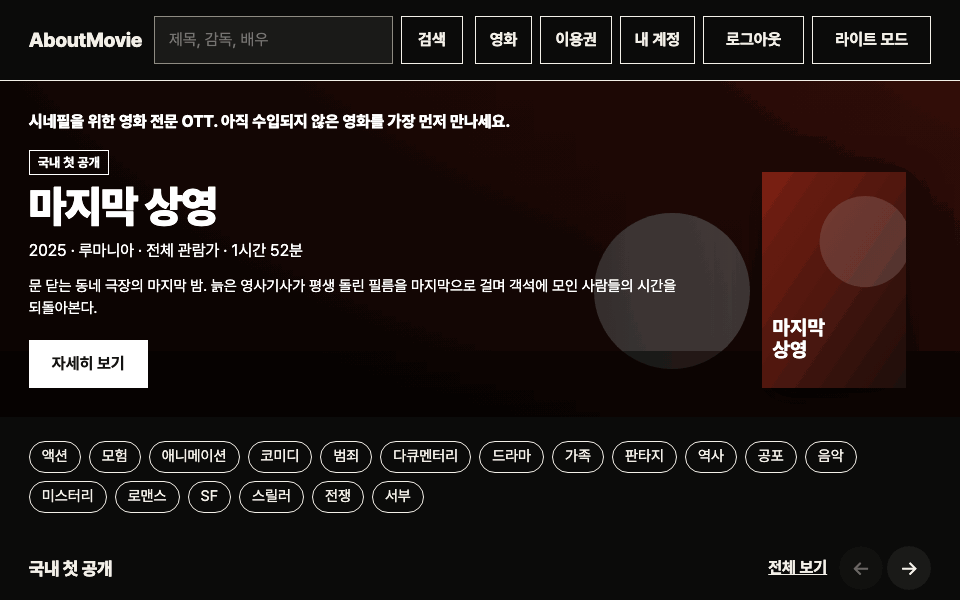

# AboutMovie

[](https://github.com/ryushin01/AboutMovie/actions/workflows/ci.yml)
[](https://github.com/ryushin01/AboutMovie/releases/latest)

평론가 한 사람이 쓴 장문의 영화 리뷰를 싣는 사이트입니다.

**[사이트 보기](https://about-movie-ryushin.netlify.app/)** · 방문자는 가입 없이 읽고, 글은 운영자 계정으로만 씁니다.

> **프로젝트 상태:** **포트폴리오 프로젝트**입니다. 실제 평론가가 운영하는 사이트가 아니며, 처음 보이는 영화와 리뷰는 모두 가상 데이터입니다.

## 화면

화면의 영화와 리뷰는 모두 가상 데이터이고, 포스터와 본문 이미지는 코드로 그린 것입니다.



| 목록 (다크 모드) | 목록 (라이트 모드) |
|---|---|
|  |  |

| 리뷰 상세 | 리뷰 쓰기 |
|---|---|
|  |  |

## 주요 기능

- 대표 리뷰와 최신·평론가 추천·장르별 포스터 줄. 화면 폭에 따라 한 줄에 2~8편이 보임
- 모든 방문자에게 같은 글이 공개되고, 로그인 없이 읽기 가능
- 운영자 로그인. 쓰기 권한은 서버가 요청마다 역할로 확인
- Tiptap 편집기: 제목, 굵게, 기울임, 밑줄, 인용, 목록, 링크, 본문 이미지 (이미지마다 대체 텍스트 필수)
- 포스터와 본문 이미지 업로드 (장당 10MB 이하, 큰 이미지는 자동 축소)
- 작성 중 나가기 전 확인
- 다크 모드 (처음에는 시스템 설정을 따르고, 고른 값을 기억)

## 기술 스택


| 구분 | 사용 기술 |
|---|---|
| 프레임워크 | React 19, Vite 8, TypeScript 7, React Router 8 |
| 상태·데이터 | TanStack Query v5 |
| 서버 | Netlify Functions, Netlify Database (PostgreSQL), Netlify Blobs (이미지), Netlify Identity (로그인) |
| 편집기 | Tiptap 3 |
| 스타일 | Emotion, Pretendard |
| 품질 | oxlint, Prettier, Vitest + React Testing Library, Playwright + axe (Chromium, Firefox, WebKit E2E) |
| 배포 | Netlify, GitHub Actions |
| 자동화 | GitHub Actions (CI, 배포 후 사이트 검사), Dependabot |

## 시작하기

Node.js 26(`.nvmrc`)과 pnpm이 필요합니다.

```bash
nvm use
pnpm install
pnpm dev         # http://localhost:5173 (함수·DB·이미지 저장소를 로컬에서 흉내 냄)
pnpm db:migrate  # 처음 한 번, pnpm dev를 켠 채로 다른 터미널에서 실행
```

로그인은 로컬에서 동작하지 않아 운영자로 간주합니다. 배포 준비는 [개발 가이드](docs/development.md#배포-전-설정)를 참고하세요.

| 명령 | 설명 |
|---|---|
| `pnpm build` | 타입 검사와 프로덕션 빌드 |
| `pnpm typecheck` / `lint` / `format` | 타입 검사 / 린트(접근성, FSD 계층 포함) / 코드 정리 |
| `pnpm test` | 단위·컴포넌트 테스트, 실제 Postgres를 쓰는 서버 테스트 |
| `pnpm test:e2e` | 프로덕션 빌드의 흐름·넘침·접근성 검사 (먼저 `build` 필요) |
| `pnpm test:live` | 배포된 사이트 검사 (`main`에 배포할 때마다 자동 실행) |
| `pnpm screenshots` / `demo-gif` | README 스크린샷 / 시연 GIF 다시 만들기 (먼저 `build` 필요) |

## 프로젝트 구조

[Feature-Sliced Design](https://feature-sliced.design)을 따릅니다. 컴포넌트 옆에 `*.test.tsx`를 둡니다.

```
.github/            CI
docs/               개발 가이드, 접근성 점검, README 스크린샷
e2e/                E2E 테스트
netlify/            함수(API), 서버 로직, DB 마이그레이션
public/seed/        가상 리뷰의 포스터와 장면
src/
├─ app/             진입점, 라우터, 전역 스타일과 테마 색상
├─ pages/           home, login, review-detail, review-new, review-edit, not-found
├─ widgets/         site-layout (머리글, 본문 바로가기, 바닥글), review-row (가로 포스터 줄)
├─ features/        review-form (편집기), delete-review, login, logout, toggle-theme
├─ entities/        review (API, 본문 규칙, 카드), session (로그인 상태)
└─ shared/          공통 UI, 경로, 유틸리티
```

## 문서

| 문서 | 내용 |
|---|---|
| [개발 가이드](docs/development.md) | 구현 판단, 테스트 구성, 배포 시 유의점, 알려진 제한 |
| [접근성 점검](docs/accessibility.md) | KWCAG 2.2 항목별 자체 점검 결과 |
| [변경 기록](CHANGELOG.md) | 버전별 변경 내용 |
