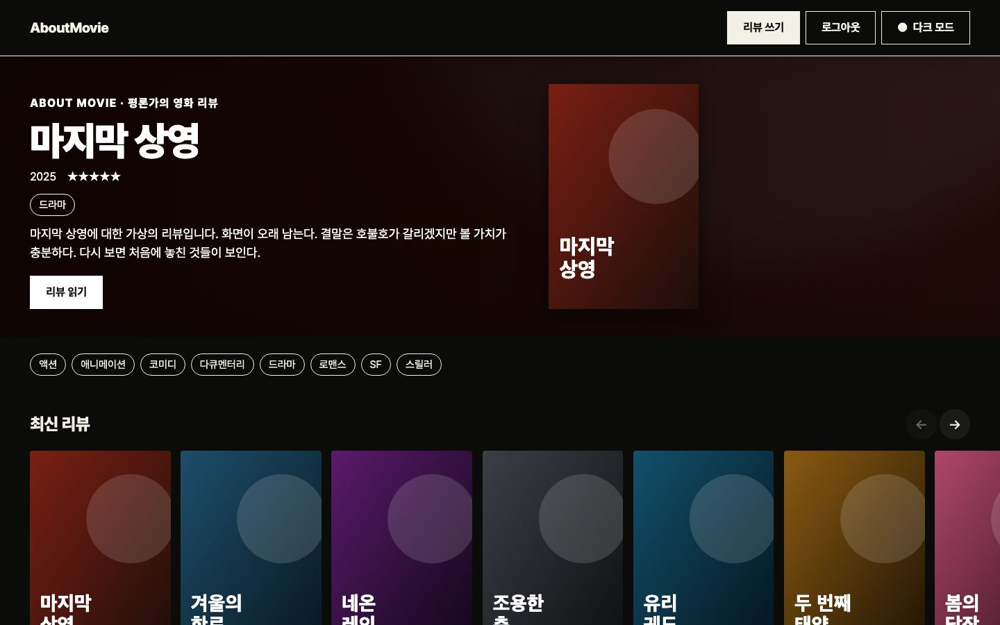
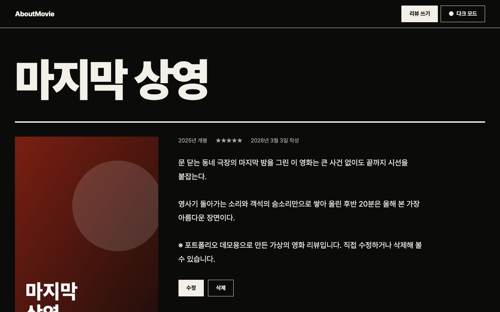
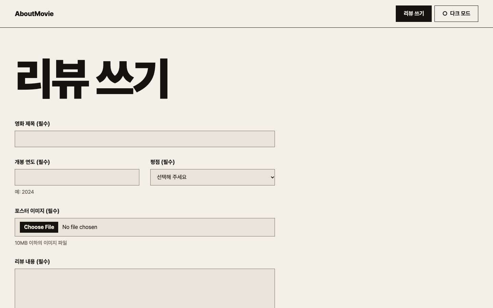

# AboutMovie


영화 포스터와 장면 이미지를 곁들여 리뷰를 쓰는 영화 리뷰 블로그입니다. 서버 없이 브라우저만으로 작성부터 저장까지 동작합니다.

> **프로젝트 상태:** **포트폴리오용 데모**입니다. 리뷰와 이미지는 방문자의 브라우저(IndexedDB)에만 저장되어 다른 사람에게 공개되지 않고, 브라우저 데이터를 지우면 함께 사라집니다. 처음 보이는 영화와 리뷰는 모두 가상 데이터입니다.

## 화면

화면의 영화와 리뷰는 모두 가상 데이터이고, 포스터와 장면 이미지는 코드로 그린 것입니다.

| 목록 (다크 모드) | 목록 (라이트 모드) |
|---|---|
|  |  |

| 리뷰 상세 | 리뷰 쓰기 |
|---|---|
|  |  |

## 주요 기능

- 리뷰 작성, 수정, 삭제 (제목, 개봉 연도, 평점, 본문)
- 포스터 이미지와 영화 속 장면 이미지 업로드 (장당 10MB 이하, 장면은 여러 장)
- 큰 이미지 자동 축소, 브라우저가 표시할 수 없는 형식은 안내 후 거부
- 장면 설명을 이미지의 대체 텍스트로 사용
- 다크 모드 (처음에는 시스템 설정을 따르고, 고른 값을 기억)
- 처음 방문하면 가상 샘플 리뷰 3편을 표시 (삭제하면 다시 생기지 않음)

## 기술 스택


| 구분 | 사용 기술 |
|---|---|
| 프레임워크 | React 19, Vite 8, TypeScript 7, React Router 8 |
| 상태·데이터 | TanStack Query v5, idb-keyval (IndexedDB) |
| 스타일 | Emotion, Pretendard |
| 품질 | Vitest + React Testing Library, Playwright + axe (E2E), Storybook 10 |

## 시작하기

Node.js 26(`.nvmrc`)과 pnpm이 필요합니다.

```bash
nvm use
pnpm install
pnpm dev    # http://localhost:5173
```

| 명령 | 설명 |
|---|---|
| `pnpm build` | 타입 검사와 프로덕션 빌드 |
| `pnpm typecheck` | 타입 검사 |
| `pnpm test` | 단위·컴포넌트 테스트 |
| `pnpm test:e2e` | 프로덕션 빌드와 모든 스토리의 흐름·넘침·접근성 검사 (먼저 `build`, `build-storybook` 필요) |
| `pnpm screenshots` | README 스크린샷 다시 만들기 (먼저 `build`, `build-storybook` 필요) |
| `pnpm storybook` | Storybook 개발 서버 (`http://localhost:6006`) |

## 프로젝트 구조

[Feature-Sliced Design](https://feature-sliced.design)을 따릅니다. 컴포넌트 옆에 `*.stories.tsx`와 `*.test.tsx`를 둡니다.

```
.storybook/         Storybook 설정
docs/               개발 가이드, README 스크린샷
e2e/                E2E 테스트
src/
├─ app/             진입점, 라우터, 전역 스타일과 테마 색상
├─ pages/           home, review-detail, review-new, review-edit, not-found
├─ widgets/         site-layout (머리글, 본문 바로가기, 바닥글)
├─ features/        review-form, delete-review, toggle-theme
├─ entities/review/ 리뷰 저장소, 쿼리, 샘플 데이터, 카드
└─ shared/          공통 UI, 경로, 유틸리티
```

## 문서

| 문서 | 내용 |
|---|---|
| [개발 가이드](docs/development.md) | 구현 판단, 테스트 구성, 접근성 점검 범위, 배포 시 유의점 |
| [변경 기록](CHANGELOG.md) | 버전별 변경 내용 |

## 향후 과제

- 데모 사이트 배포
- ESLint, Prettier, CI 구성
- KWCAG 항목별 수동 점검과 스크린 리더 확인
